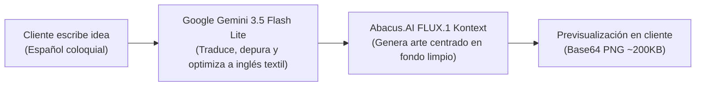

# Registro de Decisiones Técnicas (ADR / Architecture Decisions)

Este documento registra los fundamentos técnicos, compromisos y justificaciones de negocio detrás de la arquitectura y diseño de **AlquimiaTex**.

---

## 1. Estructura del Proyecto: Pragmatic Flat (Alternativa 3)

### Contexto
Durante el inicio del proyecto se evaluaron tres enfoques estructurales:
* **Alternativa 1 (Next.js Clásico / Monolítico):** Todo dentro de `src/app/` y componentes dispersos.
* **Alternativa 2 (Feature-Sliced / Dominio Estricto):** Módulos altamente anidados (`features/orders/components`, `features/orders/hooks`, etc.).
* **Alternativa 3 (Pragmatic Flat):** Estructura plana con separación funcional en `components/public`, `components/admin`, `components/ui`, `actions/` y `lib/`.

### Decisión
Se adoptó la **Alternativa 3 (Pragmatic Flat)**.

### Justificación
* El proyecto cuenta con un equipo de desarrollo ágil y dos contextos principales de usuario: clientes (`public`) y socios (`admin`).
* Minimiza la profundidad de directorios (máximo 3-4 niveles), facilitando la navegación rápida.
* Desacopla la lógica de servidor en `actions/`, permitiendo que el asistente de pedidos invoque Server Actions sin duplicar lógica de base de datos.

---

## 2. Formulario como Wizard de 3 Pasos vs. Vista Única (Single Page Form)

### Contexto
Se consideró colocar todas las opciones (producto, diseño, subida de foto, contacto y pago) en un único scroll vertical continuo.

### Decisión
Se estructuró el flujo en un **Asistente de 3 Pasos (Wizard)**:
* **Paso 1:** Selección de productos y carrito (hasta 10 artículos).
* **Paso 2:** Personalización por artículo (descripción, fotos de referencia e IA).
* **Paso 3:** Contacto, fecha de entrega, resumen general y abono del 30%.

### Justificación
* **Carga Cognitiva:** Un formulario único con personalización de múltiples artículos genera un scroll excesivo e intimidante en teléfonos inteligentes (el 85% de los clientes en Caracas navegan desde móviles).
* **Validación Progresiva:** Permite verificar que cada producto tenga talla, corte o color antes de permitir escribir descripciones o subir fotos.
* **Manejo de Memoria:** Aislar el generador visual en el Paso 2 evita renderizados pesados e innecesarios mientras el cliente simplemente decide cuántas franelas necesita.

---

## 3. Eliminación de Pasarelas Automáticas a Favor de Pagos Manuales

### Contexto
Inicialmente se contempló integrar pasarelas de pago automatizadas.

### Decisión
Se removió cualquier SDK o pasarela de cobro automático, adoptando **instrucciones de pago manual con requisito del 30% de abono** (Pago Móvil, Binance USDT y Efectivo en Taller).

### Justificación
* **Realidad Bancaria Nacional:** En Venezuela, las comisiones de pasarelas de pago para e-commerce en bolívares suelen requerir trámites corporativos engorrosos, comisiones fijas elevadas o dependencias de terceros propensas a caídas.
* **Flexibilidad de Cotización:** En sublimación personalizada, los pedidos con requerimientos especiales (ej: tallas 3XL, mangas largas o tintas especiales) requieren que los socios coticen directamente con el cliente antes de cobrar el 100%.
* **Confianza del Cliente:** El modelo del **30% de abono** protege al taller ante cancelaciones intempestivas y ofrece tranquilidad al comprador, quien liquida el 70% restante al recibir o retirar su encargo en La Dolorita.
* **Control Humano:** Los 3 socios validan directamente el comprobante en su cuenta bancaria/Binance y actualizan el estado en el panel de administración.

---

## 4. Migración de Pollinations.ai a Abacus.AI (FLUX.1 Kontext)

### Contexto
Inicialmente se probó Pollinations.ai como alternativa rápida y gratuita, pero presentaba inconsistencias en la disponibilidad del servicio y falta de control sobre los modelos subyacentes.

### Decisión
Se migró formalmente a la API oficial de **Abacus.AI RouteLLM** utilizando el modelo **FLUX.1 Kontext (`flux_kontext`)**.

### Justificación
* **Estabilidad y SLA Comercial:** Abacus.AI proporciona una API empresarial con cuotas claras, metering transparente y acuerdos de disponibilidad garantizados.
* **Optimización de Costos:** Se seleccionó `flux_kontext` por ser el modelo de rasterizado visual más económico de su catálogo (**4 créditos por generación**, `pro_rate: 4`).
* **Fidelidad Estética:** FLUX.1 destaca ampliamente sobre modelos antiguos en la generación de gráficos vectoriales, bordes definidos y fondos limpios, indispensables para el corte y planchado textil.

---

## 5. Pipeline Híbrido: Optimización de Prompts con Gemini antes de FLUX.1

### Contexto
Los clientes finales escriben descripciones coloquiales en español, desordenadas y con jerga local (ej: *"quiero una franela con un dragón bien brutal estilo animé pero con morado"*). Al enviar este texto crudo a modelos de imagen como FLUX.1, estos generan composiciones confusas, fondos oscuros no aptos para sublimación, o exceden el tiempo de respuesta.

### Decisión
Implementar un paso intermedio en el backend donde **Google Gemini (`gemini-3.5-flash-lite`)** actúa como un *Prompt Engineer* automático antes de llamar a Abacus.AI.

### Justificación
* **Velocidad de Gemini:** `gemini-3.5-flash-lite` procesa la optimización en menos de 1.5 segundos.
* **Calidad de Salida:** Transforma el texto del usuario en un prompt conciso en inglés (ej: *"Centered graphic of a dragon, anime aesthetic, vibrant neon purple and cyan, clean isolated white background, flat sublimation textile print ready"*).
* **Resiliencia:** Si la API de Gemini sufre una intermitencia momentánea, el sistema cuenta con un fallback automático que estructura el prompt del cliente en una plantilla base en inglés sin interrumpir el flujo.

---

## 6. Uso de `window.location.href` vs. `window.open` para WhatsApp

### Contexto
Al confirmar el pedido en el Paso 3, se intentó abrir la conversación de WhatsApp en una pestaña secundaria mediante `window.open(whatsappUrl, '_blank')` tras guardar en Supabase.

### Decisión
Se implementó redirección directa usando `window.location.href = whatsappUrl`.

### Justificación
* **Bloqueadores de Ventanas Emergentes (Pop-up Blockers):** Los navegadores modernos (Google Chrome, Safari en iOS, Brave) consideran como pop-up malicioso cualquier llamada a `window.open` que se ejecute después de una promesa asíncrona (`await submitOrderAction()`). Esto causaba que la ventana de WhatsApp se bloqueara silenciosamente en el 90% de los dispositivos.
* **Compatibilidad Móvil Universal:** `window.location.href` a un enlace `https://wa.me/...` dispara inmediatamente la aplicación nativa de WhatsApp en Android e iOS, y en navegadores de escritorio abre WhatsApp Web de forma fluida.
* **Persistencia del Diálogo:** En caso de que el cliente regrese al navegador o use el botón "Atrás", el diálogo de confirmación permanece montado con el código `#ALQ-XXXX` y el botón de respaldo.

---

## 7. Rango de Fechas de Entrega: 3 a 7 Días Hábiles

### Contexto
Los clientes a menudo solicitan pedidos para el mismo día o el día siguiente (pedidos exprés de emergencia).

### Decisión
El selector de fecha del Paso 3 calcula dinámicamente fechas mínimas y máximas **excluyendo sábados y domingos**:
* **Mínimo:** `Hoy + 3 días hábiles`
* **Máximo:** `Hoy + 7 días hábiles`
* Etiqueta obligatoria: `⏳ Tiempo estimado: 3 a 7 días hábiles desde la confirmación del 30% de abono`.

### Justificación
* **Capacidad Operativa del Taller:** El proceso artesanal de sublimación requiere compra de prendas base, ajuste vectorial de artes, impresión en papel para sublimación con secado de tinta, prensado térmico a 200°C y control de calidad.
* **Protección contra Promesas Incumplidas:** Evita que el cliente seleccione fechas inviables para los socios.
* **Excepción controlada:** Pedidos de extrema urgencia se negocian de forma extraordinaria directamente por el chat de WhatsApp con recargo especial.

---

## 8. Límites de Negocio: 10 Artículos por Pedido y 3 Intentos de IA

### Contexto
Un carrito sin límites en una web pública puede saturar la base de datos o el ancho de banda del servidor.

### Decisión
* **Máximo 10 artículos por pedido.**
* **Máximo 3 intentos globales de IA por pedido.**

### Justificación
* **Límite de Artículos (10):** El 95% de los clientes finales al detal encargan entre 1 y 6 artículos. Pedidos superiores a 10 unidades son considerados cotizaciones corporativas o al mayor, las cuales requieren negociación directa de precios por volumen vía WhatsApp.
* **Límite de IA (3 intentos):** La generación con FLUX.1 consume créditos reales de la API (4 créditos por imagen). Tres intentos son más que suficientes para que el cliente visualice una dirección artística, protegiendo el presupuesto de consumo de IA del taller contra abuso o bots.

---

## 9. Límite de 500 Caracteres en el Campo de Descripción

### Contexto
El campo de texto para describir el estampado tenía un límite inicial de 1000 caracteres, lo que permitía enviar párrafos masivos de texto que ralentizaban la inferencia gráfica en Abacus.AI (>45 segundos) y provocaban errores de timeout.

### Decisión
Reducir el límite a **500 caracteres máximo**, validado tanto en el cliente (Zod y React Hook Form) como en la API backend.

### Justificación
* **Eficiencia de Difusión:** Los modelos de rasterizado como FLUX.1 logran su mayor fidelidad cuando el prompt condensa elementos clave (sujeto, paleta de colores, estilo y composición). Textos de más de 500 caracteres introducen ruido y contradicciones en la imagen.
* **Tiempo de Respuesta:** Prompts optimizados por debajo de 500 caracteres se resuelven en 8 a 15 segundos en Abacus.AI, brindando una experiencia de usuario fluida y libre de timeouts.

---

## 10. Directivas de Rendimiento en Imágenes (`next/image` y Data URLs)

### Decisión
Se aplicó la propiedad `unoptimized` a los componentes `<Image />` de Next.js cuando procesan previsualizaciones locales en formato Data URL (`data:image/...`).

### Justificación
El optimizador de imágenes nativo de Next.js (`/_next/image`) está diseñado para optimizar recursos HTTP remotos o estáticos en el disco. Al intentar optimizar cadenas base64 Data URLs en memoria, Next.js emite advertencias o bloquea el renderizado. El atributo `unoptimized` permite renderizar instantáneamente las imágenes subidas por el cliente y las generadas por FLUX.1 sin sobrecargar el servidor de Node.js.
