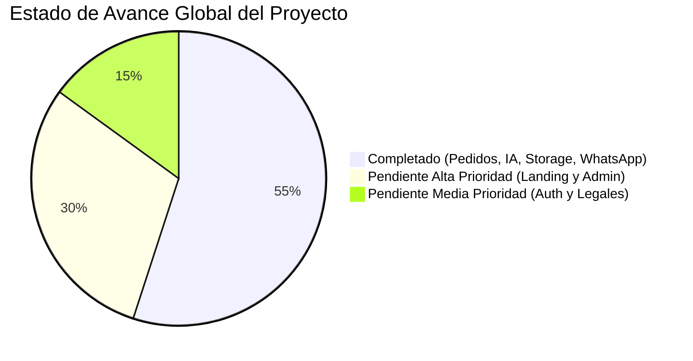

# Estado del Proyecto: AlquimiaTex

**Última actualización:** 14 de Octubre de 2026  
**Último commit:** `7f5cad9` — *Número de WhatsApp oficial configurado y redirección directa sin pop-up blocker*  
**Estado general del MVP:** ~55% completado (Núcleo de pedidos e IA 100% operativo)

---

## 1. Resumen Ejecutivo

### ¿Qué es AlquimiaTex?
**AlquimiaTex** es un taller artesanal de sublimación textil y personalización de artículos (camisas/franelas, mousepads, rompecabezas, tazas y artículos promocionales) ubicado en **La Dolorita, Petare / Caracas, Venezuela**.

### Socios y Operación
El proyecto es operado activamente por **3 socios**, encargados del diseño gráfico, sublimado en plancha térmica, compras de insumos, atención al cliente y despacho de pedidos.

### Problema que Resuelve
En el mercado venezolano, la cotización de artículos personalizados suele realizarse mediante intercambios caóticos por mensajes directos de WhatsApp o Instagram, donde se extravían especificaciones de tallas, colores, cortes y fotos de referencia. 

AlquimiaTex resuelve esto proporcionando:
1. Un **asistente de pedidos web interactivo y mobile-first** donde el cliente configura con precisión hasta 10 artículos por pedido.
2. Un **generador de conceptos visuales con Inteligencia Artificial** para ayudar al cliente a plasmar su idea gráfica antes de confeccionar.
3. **Cero fricción de cobro**: Presentación transparente de instrucciones de pago manual (Pago Móvil, Binance USDT, Efectivo en taller con 30% de abono) y redirección con el pedido formateado al canal oficial de WhatsApp de los socios.
4. **Almacenamiento seguro en la nube** de las imágenes de referencia y pedidos en Supabase.

---

## 2. Stack Tecnológico y Versiones

| Tecnología | Versión | Propósito en AlquimiaTex |
| :--- | :--- | :--- |
| **Next.js** | `14.2.35` | Framework React con App Router, Server Actions y API Routes |
| **React / React DOM** | `^18.3.1` | Biblioteca de renderizado y componentes de interfaz |
| **TypeScript** | `^5.0.0` | Tipado estricto en cliente, esquemas y servidor |
| **Tailwind CSS** | `^3.4.1` | Framework de diseño utilitario y responsivo |
| **shadcn/ui** | `^4.21.4` | Sistema base de componentes accesibles y personalizables |
| **Zod** | `^4.6.7` | Validación de esquemas de datos en cliente y servidor |
| **react-hook-form** | `^7.90.0` | Manejo de formularios performantes sin re-renders innecesarios |
| **@hookform/resolvers** | `^5.9.1` | Integración entre React Hook Form y Zod |
| **Supabase Client & SSR** | `^2.117.3` / `^0.12.7` | Base de datos PostgreSQL y Storage bucket (`order-references`) |
| **Google GenAI SDK** | `^2.29.1` | Optimización de prompts con modelo `gemini-3.5-flash-lite` |
| **Abacus.AI RouteLLM** | API v1 | Generación de rasterizado visual con modelo `flux_kontext` (FLUX.1) |
| **Lucide React** | `^1.56.0` | Iconografía del sistema |

---

## 3. Estructura de Carpetas Elegida (Pragmatic Flat - Alternativa 3)

Se seleccionó la arquitectura **Pragmatic Flat** para equilibrar organización, mantenibilidad y rapidez de desarrollo para un equipo ágil:

```text
src/
├── actions/        # Server Actions (subida de archivos, inserción de órdenes)
├── app/            # App Router: páginas públicas (/pedido, /) y API routes (/api/generate-preview)
├── components/     # Componentes modulares
│   ├── admin/      # Componentes del futuro panel administrativo
│   ├── public/     # Componentes del asistente de pedidos (Paso 1, 2, 3 y modales)
│   ├── shared/     # Componentes compartidos
│   └── ui/         # Componentes base atómicos de diseño (shadcn/ui)
├── lib/            # Lógica auxiliar: supabase, schemas, constants, utils, whatsapp
└── types/          # Definiciones e interfaces globales de TypeScript
```

### Justificación de la Elección:
* **Evita la sobre-ingeniería:** Evita la complejidad excesiva de *Feature-Sliced Design* o *Atomic Design* estricto de 7 capas, permitiendo encontrar cualquier archivo en un máximo de 2 clics.
* **Separación clara de responsabilidades:** Separa claramente los componentes de la experiencia pública de compra (`components/public/`) de los futuros componentes administrativos (`components/admin/`).
* **Server Actions desacopladas:** Toda interacción con Supabase se ubica en `actions/`, permitiendo reutilizarlas tanto en el formulario web como en futuras automatizaciones o paneles.

---

## 4. Módulos y Estado de Avance



### Módulos Completados (100% Operativos):
1. **Paso 1: Selección y Carrito Multi-Producto:**
   * Configuración de camisas (tallas adulto/niño, corte unisex/dama/oversize, colores blanco/gris jaspeado), mousepads y rompecabezas.
   * Carrito interactivo con límite de hasta 10 artículos, botón para agregar más, edición en caliente y eliminación.
2. **Paso 2: Personalización por Artículo e IA:**
   * Descripción de estampado (validación estricta de 10 a 500 caracteres).
   * Subida de imágenes de referencia de hasta 5MB (JPG, PNG, WEBP).
   * Pipeline de IA con optimizador de prompts de **Gemini 3.5 Flash Lite** y generación gráfica con **Abacus.AI FLUX.1 (`flux_kontext`)**, con límite global de 3 intentos por orden.
3. **Paso 3: Contacto, Entrega y Pagos Manuales:**
   * Selector de fecha de entrega de 3 a 7 días hábiles desde hoy (omitiendo fines de semana).
   * Instrucciones de Pago Móvil (Banesco/BDV), Binance USDT y Efectivo en Taller con requisito del 30% de abono.
   * Botones de copiado rápido al portapapeles.
4. **Infraestructura de Datos y Despacho:**
   * Subida automática de imágenes a Supabase Storage (`order-references`).
   * Generación de código único amigable (`#ALQ-XXXX`).
   * Registro del pedido en Supabase (`orders`).
   * Redirección directa hacia WhatsApp (`https://wa.me/584241589317`) sin bloqueo de pop-up blocker.
5. **Persistencia Local:** Sincronización continua de pasos, carrito e intentos en `localStorage`.

### Módulos Pendientes y Prioridad:

| Módulo | Prioridad | Estimación | Descripción |
| :--- | :---: | :---: | :--- |
| **Landing Page Pública (`/`)** | **Alta** | Media | Portada con catálogo visual de productos, fotos del taller en La Dolorita y llamado a la acción hacia `/pedido`. |
| **Panel Administrativo (`/admin`)** | **Alta** | Alta | Tabla de gestión de pedidos, visualizador de comprobantes de pago, visor de imágenes de referencia y cambio de estado manual. |
| **Autenticación de Socios** | **Media** | Baja | Login seguro con Supabase Auth para restringir el acceso a `/admin` únicamente a los 3 socios. |
| **Páginas Informativas y Legales** | **Media** | Baja | `/terminos`, `/politicas-devolucion`, `/preguntas-frecuentes`. |
| **Fase 2: Pasarela de Cobro Automática** | **Baja** | Alta | Evaluación a futuro de pasarelas locales o internacionales cuando el volumen lo requiera. |

---

## 5. Dependencias Instaladas (`package.json`)

```json
{
  "dependencies": {
    "@base-ui/react": "^1.9.0",
    "@google/genai": "^2.29.1",
    "@hookform/resolvers": "^5.9.1",
    "@supabase/ssr": "^0.12.7",
    "@supabase/supabase-js": "^2.117.3",
    "class-variance-authority": "^0.7.1",
    "clsx": "^2.1.1",
    "cn": "^0.4.0",
    "lucide-react": "^1.56.0",
    "next": "14.2.35",
    "react": "^18",
    "react-dom": "^18",
    "react-hook-form": "^7.90.0",
    "shadcn": "^4.21.4",
    "tailwind-merge": "^3.7.0",
    "tailwindcss-animate": "^1.0.7",
    "tw-animate-css": "^1.4.0",
    "zod": "^4.6.7"
  },
  "devDependencies": {
    "@types/node": "^20",
    "@types/react": "^18",
    "@types/react-dom": "^18",
    "eslint": "^8",
    "eslint-config-next": "14.2.35",
    "eslint-config-prettier": "^10.1.8",
    "postcss": "^8",
    "prettier": "^3.9.10",
    "prettier-plugin-tailwindcss": "^0.8.1",
    "tailwindcss": "^3.4.1",
    "typescript": "^5"
  }
}
```

---

## 6. Variables de Entorno Requeridas

Las siguientes variables son obligatorias en `.env.local` (protegidas por `.gitignore`):

* `NEXT_PUBLIC_SUPABASE_URL`: URL del proyecto Supabase.
* `NEXT_PUBLIC_SUPABASE_ANON_KEY`: Llave pública anónima de Supabase.
* `NEXT_PUBLIC_WHATSAPP_NUMBER`: Número oficial de WhatsApp del taller para recibir pedidos (`584241589317`).
* `GEMINI_API_KEY`: API Key de Google Gemini para optimización de prompts en lenguaje natural.
* `ABACUS_API_KEY`: API Key de Abacus.AI para la generación de imágenes con FLUX.1.
* `ABACUS_BASE_URL`: URL base de la API de Abacus (por defecto: `https://routellm.abacus.ai/v1`).
