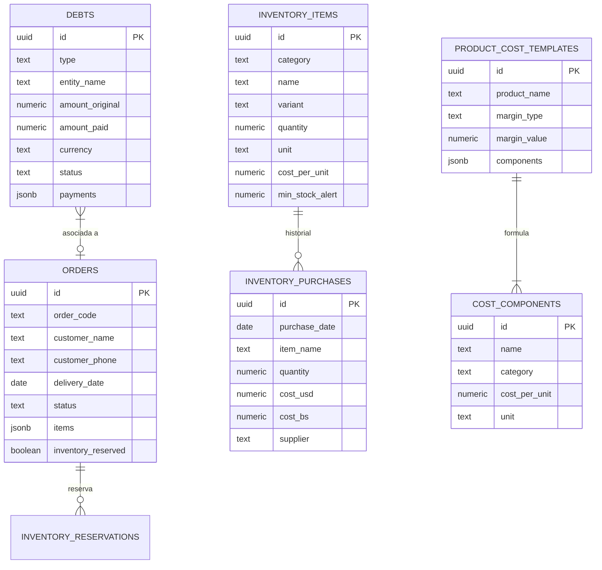

# 📜 INFORME MAESTRO DE TRANSFERENCIA DE CONTEXTO — ALQUIMIATEX
> **Documento Oficial de Continuidad Técnica, Arquitectura y Operación del Negocio**  
> **Última Actualización:** 20 de Noviembre de 2026  
> **Versión del Sistema:** v1.5.0 (Producción)

---

## 1. Resumen del Negocio y Stack Tecnológico

### ¿Qué es AlquimiaTex?
**AlquimiaTex** es un taller artesanal de sublimación textil y personalización de artículos ubicado en **La Dolorita, Petare, Caracas, Venezuela**.
El taller es operado conjuntamente por **3 socios con roles equitativos**:
- **Socio 1:** Diseño gráfico y conceptos visuales.
- **Socio 2:** Sublimado en plancha térmica y confección.
- **Socio 3:** Ventas, compras de insumos y logística de despachos.

### Catálogo de Productos Oficial
1. **Camisas / Franelas:**
   - Telas: Microdurazno (blanca y negra), Jersey/Poliéster 50-50, Algodón Peinado, Oversize.
   - Cortes: Caballero, Dama.
   - Tallas: Adulto (S, M, L, XL, XXL) y Niños (2 a 16).
2. **Tazas:** Normal Blanca, Taza Mágica (revela con calor), Set Apilable.
3. **Mousepads:** Estándar (22 x 18 cm).
4. **Rompecabezas:** Formato A4 (aprox. 120 piezas).
5. **Artículos Varios:** Cojines, gorras, tulas y artículos promocionales bajo pedido.

### Reglas de Negocio Clave
- **Tiempos de Entrega:** 4 a 7 días hábiles a partir de la confirmación del pago/abono.
- **Política de Pagos:**
  - **Pedidos al Detal (Unidad):** 100% anticipado obligatorio.
  - **Pedidos al Mayor (Docena - 12+ unidades):** 50% abono inicial + 50% contra entrega.
- **Métodos de Pago:** Pago Móvil (Banesco/BDV), Binance Pay USDT y Efectivo en Taller (USD y Bs.).
- **Diseño Gráfico:** Mockup digital gratuito previo al planchado. Máximo 2 estampados por prenda (pecho y espalda).
- **Límites de Pedido Web:** Hasta 10 artículos por orden y 3 intentos de generación con IA por cliente.

---

### Stack Tecnológico
| Capa | Tecnología | Versión | Propósito |
| :--- | :--- | :--- | :--- |
| **Framework** | **Next.js** | `14.2.35` | React App Router, Server Actions, Server Components y Route Handlers |
| **Lenguaje** | **TypeScript** | `^5.0.0` | Tipado estricto en cliente, esquemas y servidor |
| **Estilos** | **Tailwind CSS** | `^3.4.1` | Diseño responsivo estilo "Taller Experimental / Neo-Brutalist" |
| **Componentes UI** | **shadcn/ui** | `^4.21.4` | Componentes accesibles, diálogos, selectores y formularios |
| **Iconografía** | **Lucide React** | `^1.56.0` | Iconos del sistema y panel de control |
| **Formularios & Zod** | **react-hook-form + Zod** | `^7.90.0` / `^4.6.7` | Validación robusta de formularios en cliente y servidor |
| **Base de Datos & Auth** | **Supabase** | `^2.117.3` / `^0.12.7` | PostgreSQL, Storage Buckets, Autenticación SSR con Cookies |
| **Inteligencia Artificial** | **Google Gemini + Abacus.AI** | API v1 | Optimización de prompts con Gemini Flash y renderizado con FLUX.1 Kontext |
| **Hospedaje & Deploy** | **Vercel** | Hobby Plan | Despliegue CI/CD continuo conectado a GitHub |
| **Control de Versiones** | **Git & GitHub** | — | Repositorio centralizado |

---

## 2. URLs Clave del Ecosistema

- **Producción Oficial:** [https://alquimia-tex.vercel.app](https://alquimia-tex.vercel.app)
- **Panel Administrativo:** [https://alquimia-tex.vercel.app/admin](https://alquimia-tex.vercel.app/admin)
- **Asistente de Pedidos Público:** [https://alquimia-tex.vercel.app/pedido](https://alquimia-tex.vercel.app/pedido)
- **Repositorio GitHub:** [https://github.com/yermaldana-creator/AlquimiaTEX](https://github.com/yermaldana-creator/AlquimiaTEX)
- **Dashboard de Supabase:** `https://supabase.com/dashboard/project/ihbaunncxkskesiqsgap`
- **Servidor Local de Desarrollo:** `http://localhost:3000` (o `http://localhost:3001`)
- **Canal Oficial WhatsApp:** [+58 424 1589317](https://wa.me/584241589317)
- **Instagram Oficial:** [@alquimia_tex](https://instagram.com/alquimia_tex)

---

## 3. Cuentas y Correos Electrónicos del Proyecto
*(Por estrictas razones de seguridad cibernética, no se incluyen contraseñas en este documento).*

1. **GitHub:**
   - Usuario / Organización: `yermaldana-creator`
   - Repositorio: `yermaldana-creator/AlquimiaTEX`
   - Configuración Git Local: `AlquimiaTex <dev@alquimiatex.local>`
2. **Vercel:**
   - Proyecto: `alquimia-tex`
   - Dominio de producción: `alquimia-tex.vercel.app`
   - Vinculado a la cuenta de GitHub `yermaldana-creator`.
3. **Supabase:**
   - Organización: `yermaldana-creator's Org`
   - Proyecto: `alquimiatex`
   - Project ID / Reference: `ihbaunncxkskesiqsgap`
   - Región: `us-east-1` (N. Virginia)
4. **Acceso de Socios al Panel Admin (`/admin/login`):**
   - Autenticación gestionada mediante **Supabase Auth**.
   - Los correos registrados corresponden a los correos personales/laborales de los socios de AlquimiaTex autorizados con rol activo en la base de datos.
5. **Abacus.AI / RouteLLM:**
   - Suscripción activa para generación de imágenes (FLUX.1 Kontext).

---

## 4. Estructura de la Base de Datos en Supabase

El sistema cuenta con **6 tablas principales y 1 bucket de almacenamiento**, con políticas de seguridad **Row Level Security (RLS)** activas:



### Detalle de las Tablas:
1. **`orders` (Pedidos de Clientes):**
   - Registra todos los pedidos generados desde la web.
   - Estados oficiales (6): `pendiente_contacto`, `abono_verificado`, `en_produccion`, `listo_para_entrega`, `entregado`, `cancelado`.
   - Controla si el pedido ya reservó material en el taller (`inventory_reserved = true`).
2. **`inventory_items` (Almacén e Inventario Activo):**
   - 65+ insumos y prendas base migradas directamente del Excel del taller.
   - Categorías: `material`, `tela`, `prenda`, `otro`.
   - Cuenta con soporte de soft-delete (`archived_at`).
3. **`inventory_purchases` (Histórico de Compras):**
   - 195 compras históricas registradas con montos en USD y en Bs., cantidades y proveedores.
4. **`cost_components` (Insumos Base de Costeo):**
   - 11 componentes de fabricación (hojas de sublimación, tintas, empaques, mano de obra, prendas lisas).
5. **`product_cost_templates` (Fórmulas de Costos y Precios):**
   - Recetas para calcular el costo exacto y precio sugerido según el tipo de margen (`fixed`, `percentage`, `target_price`).
6. **`debts` (Gestión de Cuentas y Deudas):**
   - 200 cuentas migradas del Excel:
     - **187 Cuentas por Cobrar (Clientes):** Total $2,180.80 USD y Bs. 49,300.00.
     - **13 Cuentas por Pagar (Proveedores / Taller):** Total $8.50 USD y Bs. 7,114.93.
   - Estados: `pendiente`, `parcial`, `pagada`, `vencida`.
   - Soporte bimonetario (`USD` y `BS`).
   - Bitácora de abonos parciales almacenada en el campo `payments` (JSONB).
7. **Storage Bucket `order-references`:**
   - Bucket público donde se almacenan las fotos de referencia subidas por los clientes en el asistente web.

---

## 5. Variables de Entorno Requeridas

Para el correcto funcionamiento en local (`.env.local`) y en Vercel (**Project Settings > Environment Variables**), se requieren las siguientes claves:

```env
# Conexión con Supabase
NEXT_PUBLIC_SUPABASE_URL=
NEXT_PUBLIC_SUPABASE_ANON_KEY=
SUPABASE_SERVICE_ROLE_KEY=
SUPABASE_SECRET_KEY=

# Canal de Comunicación
NEXT_PUBLIC_WHATSAPP_NUMBER=

# Pipeline de Inteligencia Artificial
GEMINI_API_KEY=
ABACUS_API_KEY=
ABACUS_BASE_URL=
```

> [!IMPORTANT]
> En Vercel, es indispensable que `SUPABASE_SERVICE_ROLE_KEY` esté configurada en las Environment Variables del proyecto. Esto permite que las Server Actions administrativas consulten la base de datos sin bloqueos de RLS.

---

## 6. Estado Actual del Proyecto: ¿Qué está terminado y qué falta?

### ✅ Módulos Terminados (100% Operativos):
1. **Experiencia Pública:**
   - Landing page oficial con estética "Taller Experimental / Streetwear".
   - Asistente de pedidos `/pedido` de 3 pasos con carrito interactivo.
   - Pipeline de IA para generación de conceptos gráficos preliminares.
   - Generación de código amigable (`#ALQ-XXXX`) y despacho directo a WhatsApp.
   - Encuesta de satisfacción y feedback beta `/feedback`.
2. **Sub-módulo 1 — Autenticación y Seguridad:**
   - Sistema de login seguro `/admin/login` con cookies HTTP-only vía `@supabase/ssr`.
   - Rate limiting por IP (máximo 5 intentos por minuto para prevenir ataques de fuerza bruta).
   - Middleware de protección perimetral para todas las rutas `/admin/*`.
3. **Sub-módulo 2A — Gestión de Pedidos:**
   - Tabla interactiva con búsqueda en vivo, filtros por estado, paginación y vista de detalle `/admin/pedidos/[id]`.
   - Cambio de estados operativos en un clic.
4. **Sub-módulo 2B — Inventario del Taller:**
   - Control de existencias, cálculo del capital estimado en almacén, alertas visuales de stock bajo.
5. **Sub-módulo 3 — Costos y Precios:**
   - Catálogo de insumos base, fórmulas de costeo dinámico, análisis de rentabilidad y simulador de pedidos por volumen.
6. **Sub-módulo 4 — Conexión Pedidos ➔ Inventario:**
   - Deducción y reserva automática de materiales en almacén al pasar un pedido a producción.
7. **Sub-módulo 5 — Gestión de Deudas y Cuentas:**
   - Monitoreo bimonetario ($ / Bs.), registro de abonos parciales, saldo restante visual con barra de progreso, liquidación rápida en 1 clic y auditoría de pagos.
8. **Estrategia de Caché Dinámica:**
   - Páginas del admin configuradas con `force-dynamic` y `revalidate = 0` para garantizar lectura en tiempo real en producción.

### 📋 Trabajo Futuro / Mejoras Opcionales:
- Generación de reportes PDF descargables para balances mensuales y cierres de caja.
- Webhook o bot de WhatsApp para notificar automáticamente al cliente cuando su pedido pase a estado *"Listo para entrega"*.
- Pasarela de cobro automatizada (Binance Pay API o Pago Móvil automático) cuando el taller formalice su registro mercantil.

---

## 7. Instrucciones para Levantar el Proyecto Localmente

### Requisitos Previos:
- Node.js versión 18.18 o superior (recomendado Node 20 LTS).
- Gestor de paquetes `npm`.
- Git instalado.

### Paso a Paso:
1. **Clonar el repositorio:**
   ```bash
   git clone https://github.com/yermaldana-creator/AlquimiaTEX.git
   cd AlquimiaTEX
   ```

2. **Instalar dependencias:**
   ```bash
   npm install
   ```

3. **Configurar el archivo de entorno:**
   Crear un archivo `.env.local` en la raíz del proyecto y pegar las variables de entorno con sus valores correspondientes.

4. **Ejecutar el servidor local de desarrollo:**
   ```bash
   npm run dev
   ```
   Abrir en el navegador: [http://localhost:3000](http://localhost:3000)

5. **Comandos Útiles:**
   - `npm run lint` — Verifica reglas de tipado y estilo de código.
   - `npm run build` — Compila el proyecto en modo producción para validar errores de compilación.
   - `npx tsx scripts/migrate-excel.ts` — Script para migrar inventario, compras y costos desde el archivo Excel `data/Libro11.xlsx`.
   - `npx tsx scripts/migrate-debts.ts` — Script para migrar las cuentas por cobrar y por pagar.
