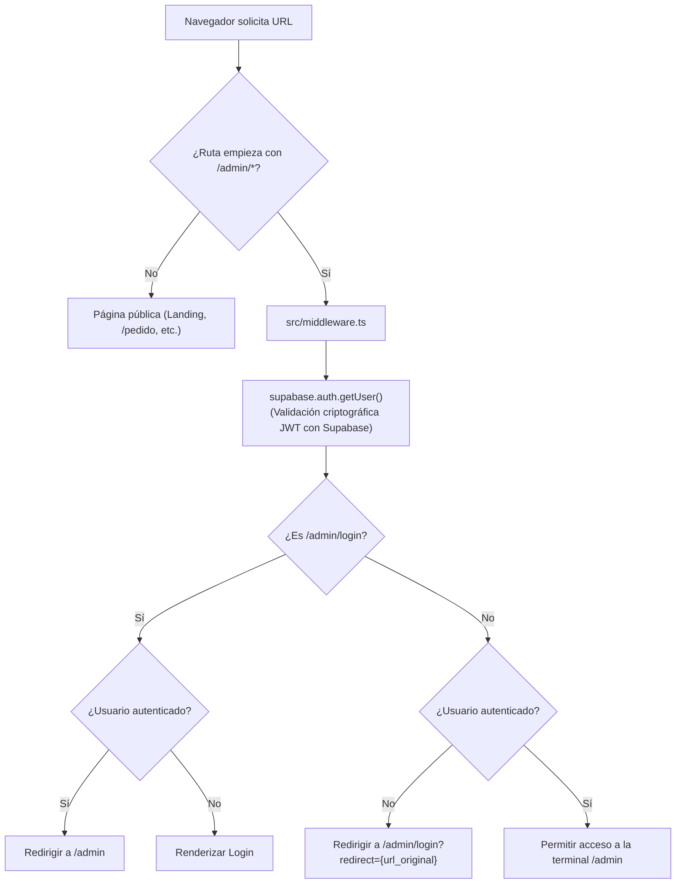

# Plan de Implementación: Fase 4 — Panel de Administración (/admin)
## Sub-módulo 1: Autenticación de Socios y Protección de Rutas

> [!IMPORTANT]
> **Contexto de Negocio:**
> Actualmente, los 3 socios de **AlquimiaTex** gestionan todo el taller (pedidos, inventario, deudas, cuentas, costos y pérdidas) en una hoja de **Excel**.
> El objetivo final del Panel Admin (`/admin`) es reemplazar completamente ese Excel mediante **5 sub-módulos progresivos**:
> 1. **Auth (Socios)** ➔ *Este sub-módulo (enfoque actual).*
> 2. **Pedidos en Vivo** (Gestión de órdenes web, WhatsApp y estados).
> 3. **Inventario** (Telas Microdurazno, Jersey, insumos de sublimación y tazas).
> 4. **Deudas / Cuentas por Cobrar** (Control de abonos del 50% vs pagos contra entrega).
> 5. **Costos y Ganancias** (Márgenes por prenda, insumos y nómina del taller).
>
> **Regla de este paso:** Los correos definitivos de los socios se crearán en Supabase tras verificar el código. Primero dejamos el sistema blindado y listo para recibir cualquier credencial.

---

## 1. Estructura de Archivos del Sub-módulo 1

```
src/
├── middleware.ts                         <-- Vigilante global de Next.js (matcher: /admin/:path*)
├── lib/
│   └── supabase/
│       ├── server.ts                     <-- Cliente Supabase SSR para Server Components y Actions
│       └── middleware.ts                 <-- Helper de sesión y refresco de cookies en Edge Runtime
├── actions/
│   └── auth.actions.ts                   <-- Server Actions: loginAction, logoutAction, getSessionUser
├── app/
│   └── admin/
│       ├── layout.tsx                    <-- Layout administrativo (marco con AdminHeader y sesión activa)
│       ├── page.tsx                      <-- Dashboard inicial del taller
│       └── login/
│           └── page.tsx                  <-- Ficha de acceso / Login
└── components/
    └── admin/
        ├── admin-header.tsx              <-- Barra superior: logotipo, badge de socio y botón Salir
        └── login-form.tsx                <-- Formulario interactivo con alertas Taller Experimental
```

### Responsabilidades por Archivo:
* **`src/middleware.ts`**: Intercepta toda petición hacia `/admin/*`. Si el visitante no tiene sesión activa, lo desvía a `/admin/login?redirect=...`. Si ya tiene sesión e intenta entrar a `/admin/login`, lo envía directo al panel.
* **`src/lib/supabase/middleware.ts`**: Inicializa `@supabase/ssr` con `getAll` / `setAll` para sincronizar las cookies entre la petición y la respuesta, refrescando automáticamente tokens vencidos.
* **`src/actions/auth.actions.ts`**:
  * `loginAction(formData)`: Llama a `supabase.auth.signInWithPassword({ email, password })`. Retorna mensajes amigables en español ante fallas de credenciales y ejecuta `redirect(redirectTo)`.
  * `logoutAction()`: Invoca `supabase.auth.signOut()` y redirige a `/admin/login`.
  * `getSessionUser()`: Valida y devuelve el objeto `User` del socio en el servidor.
* **`src/app/admin/layout.tsx`**: Contenedor principal que valida sesión del socio y monta el `AdminHeader`.
* **`src/app/admin/login/page.tsx`**: Página de login centrada con fondo crema y estética de imprenta.
* **`src/components/admin/login-form.tsx`**: Formulario cliente con campos de Correo y Clave, indicador de carga (`isPending`) y caja de error roja con borde negro retro-brutal.
* **`src/components/admin/admin-header.tsx`**: Encabezado sticky con marca AlquimiaTex, indicador `TALLER EN LÍNEA`, correo del socio activo y botón rojo de `Cerrar Sesión`.

---

## 2. Seguridad: Arquitectura de Protección de Rutas



### Claves de Seguridad:
1. **`getUser()` en lugar de `getSession()`**:
   * `getSession()` solo lee la cookie local sin comprobar si el usuario fue revocado o eliminado.
   * `getUser()` contacta y valida el token JWT contra el servidor de Supabase Auth, garantizando que solo socios reales y vigentes accedan.
2. **Refresco Transparente de Sesión**:
   * Mediante `createServerClient` de `@supabase/ssr`, las cookies de sesión expiradas se renuevan en segundo plano sin cerrar la sesión del socio a mitad de jornada.
3. **Redirección con Memoria (`?redirect=...`)**:
   * Si un socio intenta entrar directo a un enlace específico (ej. `/admin/pedidos`), el sistema recuerda la ruta y lo lleva allí automáticamente tras identificarse.

---

## 3. Diseño: Estilo "Taller Experimental" para el Panel de Socios

El panel conserva la identidad gráfica del taller en Petare, pero adaptado para ser ágil, ergonómico y de lectura rápida para el trabajo diario:

* **Paleta de Colores**:
  * Fondo general: Papel imprenta suave `#F3EFE6`.
  * Superficies de trabajo: Tarjetas blancas `#FFFFFF` o crema `#F8F5EE`.
  * Bordes y Sombras: Bordes negros sólidos de 2px (`border-2 border-black`) y sombras duras (`shadow-[3px_3px_0px_#0A0A0A]`, `shadow-[6px_6px_0px_#0A0A0A]`).
  * Acentos CMYK funcionales:
    * **Amarillo Mostaza `#FACC15`**: Botón principal de acceso y badges de atención.
    * **Cian `#06B6D4`**: Insignias de terminal activa y datos de sistema.
    * **Magenta / Carmesí `#F43F5E`**: Alertas de error y botón de cierre de sesión.
    * **Púrpura Taller `#581C87`**: Acentos de marca en títulos y badges.
* **Tipografías**:
  * `font-oswald`: Titulares de fichas y botones en mayúsculas de prensa tipográfica.
  * `font-mono`: Correos de los socios, timestamps y códigos de seguridad.
  * `font-sans`: Etiquetas de campos y textos auxiliares legibles.
* **Detalles Industriales**:
  * Insignias tipo placa técnica: `[ ACCESO RESTRINGIDO A 3 SOCIOS ]`, `[ OPERADOR DE TALLER ]`.
  * Marca de registro tipográfico `RegistrationMark` en el pie de página.

---

## 4. Pasos Exactos en Supabase (Para ejecutar cuando tengas los correos)

Cuando tú y tus socios definan los 3 correos, estos son los pasos exactos a seguir en la consola de Supabase ([supabase.com/dashboard](https://supabase.com/dashboard)):

### Paso A: Configuración de URLs Permitidas
1. En el menú lateral izquierdo, ve a **Authentication** (icono de dos personas/candado).
2. Haz clic en **URL Configuration**.
3. **Site URL**: Coloca `http://localhost:3000` (en producción será `https://alquimia-tex.vercel.app`).
4. **Redirect URLs**: Haz clic en **"Add URL"** y agrega:
   * `http://localhost:3000/**`
   * `https://alquimia-tex.vercel.app/**`
5. Haz clic en **Save changes**.

### Paso B: Verificar Proveedor de Email
1. En **Authentication**, haz clic en el submenú izquierdo **CONFIGURATION → Sign In / Providers**.
2. Verifica que **Email** tenga el interruptor en verde (**Enabled**).

### Paso C: Crear a los 3 Socios
1. En **Authentication**, ve a la pestaña **Users**.
2. Haz clic en el botón superior verde **"Add user"** y selecciona **"Create user"**.
3. Escribe el correo del socio y su contraseña (mínimo 8 caracteres).
4. ⚠️ **MUY IMPORTANTE:** Marca la casilla **"Auto Confirm User"** ✅.  
   *(Esto activa la cuenta de inmediato sin requerir confirmación por correo electrónico).*
5. Haz clic en **"Create user"**.
6. Repite para los otros 2 socios.

---

## 5. Criterios de Aceptación y Verificación

Tú mismo probarás estos 6 puntos en tu navegador:

1. **Intento sin sesión**:
   * Navegar a `http://localhost:3000/admin`.
   * 👉 *Resultado esperado:* Redirección inmediata a `http://localhost:3000/admin/login?redirect=%2Fadmin`.
2. **Login con credenciales falsas**:
   * Escribir un correo inventado y contraseña cualquiera.
   * 👉 *Resultado esperado:* Alerta visual roja con borde negro: *"Correo o contraseña incorrectos. Verifica e intenta nuevamente."* (sin alert del navegador).
3. **Login exitoso con socio real**:
   * Escribir el correo y clave creados en Supabase.
   * 👉 *Resultado esperado:* Entra a `/admin` y el header muestra el correo del socio y el botón "Cerrar Sesión".
4. **Evitar doble login**:
   * Estando logueado, visitar manualmente `/admin/login`.
   * 👉 *Resultado esperado:* Redirige automáticamente de vuelta al panel `/admin`.
5. **Cierre de sesión (Logout)**:
   * Pulsar el botón rojo "Cerrar Sesión".
   * 👉 *Resultado esperado:* Sesión destruida en Supabase y redirección limpia a `/admin/login`.
6. **Verificación de Calidad**:
   * `npm run lint` con 0 errores y 0 advertencias.
   * `npm run build` compilando con éxito todas las rutas.
   * Git commit con mensaje formal: `feat(admin): submódulo 1 - autenticación de socios con Supabase Auth y middleware de protección` y `git push`.
