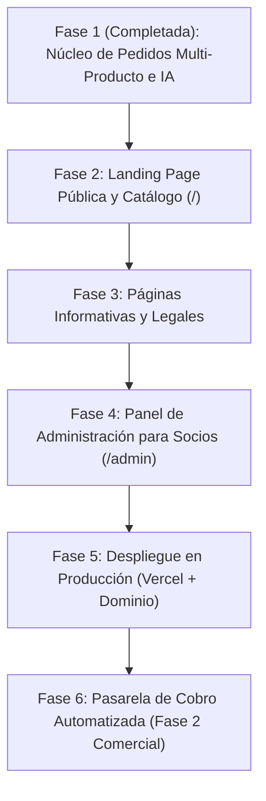

# Hoja de Ruta (Roadmap): AlquimiaTex

Este documento define la planificación secuencial de las siguientes fases de desarrollo de **AlquimiaTex**, sus objetivos, entregables específicos, criterios de aceptación y nivel de complejidad estimado.

---

## Resumen de Fases

---

## Fase 2: Landing Page Pública y Catálogo Visual (`/`)

* **Complejidad:** Media
* **Prioridad:** Alta (Siguiente paso inmediato)

### Objetivo
Construir una página de inicio moderna, atractiva y orientada a la conversión, que presente la marca AlquimiaTex, exhiba la calidad de los estampados y dirija a los clientes hacia el asistente de pedidos en [`/pedido`](file:///C:/laragon/www/AlquimiaTEX/src/app/pedido/page.tsx).

### Entregables
1. **Hero Section:** Propuesta de valor clara (*"Sublimación de alta durabilidad en Caracas"*), llamado a la acción principal (**"Personalizar mi Pedido"**) y fotos reales de productos en alta resolución.
2. **Catálogo Destacado:** Mosaico de productos base (franelas, mousepads, rompecabezas, tazas, gorras) con precios referenciales *"Desde $X"*.
3. **Sección "Cómo Trabajamos":** Explicación visual en 3 pasos (1. Configura en la web, 2. Genera o sube tu diseño, 3. Confirma tu abono por WhatsApp y recibe en Caracas).
4. **Prueba Social y Taller:** Galería fotográfica del taller artesanal en La Dolorita, Petare, mostrando las prensas térmicas y acabados reales.
5. **Preguntas Frecuentes Resumidas:** Tiempos de entrega (3 a 7 días hábiles), métodos de pago y zonas de entrega.

### Criterios de Aceptación
* Mobile-first y 100% responsivo en smartphones y pantallas de escritorio.
* Puntuación de rendimiento Lighthouse > 90 (carga rápida de imágenes optimizadas con WebP).
* Botones de acción vinculados a `/pedido` con parámetros de URL opcionales (ej: `?producto=camisa`).

---

## Fase 3: Páginas Informativas y Legales

* **Complejidad:** Baja
* **Prioridad:** Media

### Objetivo
Aportar seriedad, transparencia y respaldo legal al negocio frente a clientes nuevos y requisitos de posicionamiento SEO.

### Entregables
1. **Página de Términos y Condiciones (`/terminos`):** Cláusulas sobre el requisito indispensable del 30% de abono, tiempos de entrega hábiles y cancelaciones.
2. **Políticas de Garantía y Devolución (`/garantias`):** Política clara sobre productos textiles personalizados (garantía de estampado, reposición por fallas de fábrica y política de no reembolso una vez estampado el artículo).
3. **Página Sobre Nosotros (`/nosotros`):** Historia de los 3 socios y el compromiso de confección local en La Dolorita.

### Criterios de Aceptación
* Textos redactados en lenguaje claro y legalmente comprensible para el consumidor venezolano.
* Enlaces visibles desde el pie de página (`footer`) de todas las vistas.

---

## Fase 4: Panel de Administración para Socios (`/admin`)

* **Complejidad:** Alta
* **Prioridad:** Alta

### Objetivo
Brindar a los 3 socios una plataforma privada e intuitiva para gestionar pedidos, revisar comprobantes de pago, actualizar estados de producción y descargar artes de impresión sin depender de revisar manualmente la base de datos de Supabase.

### Sub-módulos y Entregables
1. **Autenticación Segura (`/admin/login`):**
   * Acceso exclusivo mediante correo y contraseña de los socios con Supabase Auth.
   * Middleware de Next.js protegiendo todas las rutas bajo `/admin/*`.
2. **Dashboard de Pedidos (`/admin/pedidos`):**
   * Tabla con filtros por estado: `pendiente_contacto`, `abono_verificado`, `en_produccion`, `listo_para_entrega`, `entregado`, `cancelado`.
   * Buscador por código de orden (`#ALQ-XXXX`), nombre de cliente o número telefónico.
3. **Ficha Detallada del Pedido (`/admin/pedidos/[id]`):**
   * Desglose completo de artículos con sus tallas, cortes y cantidades.
   * Visualizador a pantalla completa de imágenes de referencia y conceptos generados con IA con botón de descarga en alta resolución.
   * Botón para marcar: **"Confirmar Abono (30%)"** con registro de fecha y socio responsable.
   * Enlace directo para abrir el chat de WhatsApp con el cliente con un solo clic.
4. **Métricas Rápidas:** Contador de unidades pendientes de confección agrupadas por tipo de prenda y color de tela para compras mayoristas de insumos.

### Criterios de Aceptación
* Restricción absoluta a usuarios no autorizados (redirección a login).
* Actualización de estados en tiempo real o reactiva sin recargar la página.
* Descarga funcional de imágenes subidas a Supabase Storage con un solo clic.

---

## Fase 5: Despliegue en Producción (Vercel + Dominio Propio)

* **Complejidad:** Baja
* **Prioridad:** Alta (Una vez culminada la Landing y Admin)

### Objetivo
Publicar la plataforma en la nube global con alta disponibilidad, certificado SSL automático y dominio personalizado (ej: `alquimiatex.com` o `alquimiatex.com.ve`).

### Entregables
1. Conexión del repositorio de GitHub con **Vercel**.
2. Configuración de variables de entorno de producción en Vercel.
3. Configuración de registros DNS (A Records / CNAME) para el dominio oficial.
4. Verificación de políticas CORS y URLs públicas del bucket de Supabase.

### Criterios de Aceptación
* Certificado HTTPS activo y forzado.
* Despliegues continuos automáticos (*Continuous Deployment*) en cada merge a la rama `main`.
* Tiempos de respuesta del servidor en Caracas < 400ms en el primer byte (TTFB).

---

## Fase 6: Pasarela de Cobro Automatizada (Fase 2 Comercial)

* **Complejidad:** Alta
* **Prioridad:** Baja (Sujeto al crecimiento del volumen de ventas)

### Objetivo
Evaluar y habilitar el cobro automático con tarjeta o pasarela venezolana/cripto cuando el volumen diario de pedidos supere la capacidad de atención manual por WhatsApp.

### Entregables
1. Evaluación técnica de pasarelas locales (Bancaribe / BNC API, PagoMóvil C2P automatizado, Pipol Pay o Zinli).
2. Webhook de confirmación de pago automático que actualice el estado a `pagado` sin intervención manual.
3. Notificaciones automáticas por correo electrónico o SMS con el recibo de compra.

### Criterios de Aceptación
* Cumplimiento estricto de estándares PCI-DSS.
* Fallback automático a los métodos de pago manuales en caso de indisponibilidad de la pasarela.
